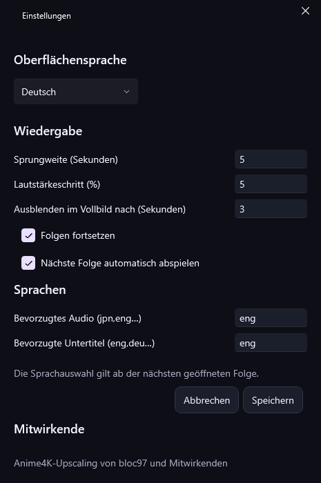
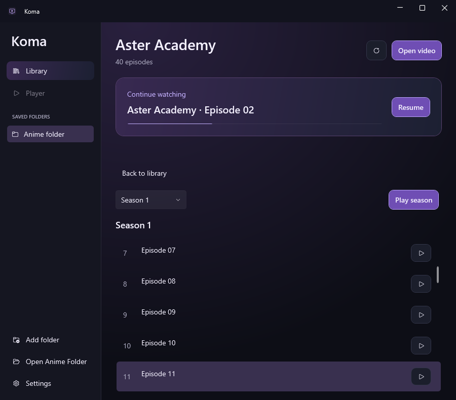
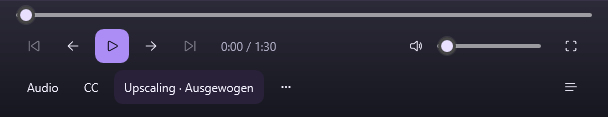

# Koma

[English](README.md) | [Deutsch](README.de.md) | [Français](README.fr.md)

Ein offline nutzbarer Anime-Player für Windows mit Anime4K-Upscaling in Echtzeit. Durchstöbere **Videos → Anime**, füge Ordner von anderen Laufwerken hinzu und setze deine Folgen mit adaptivem Upscaling fort.

Koma selbst wurde vollständig per Vibe Coding mit Codex entwickelt. Das Upscaling verwendet [Anime4K von bloc97 und Mitwirkenden](https://github.com/bloc97/Anime4K), die Wiedergabe verwendet [mpv](https://mpv.io/), und die Oberfläche verwendet [WPF UI](https://github.com/lepoco/wpfui).


Die Screenshots zeigen die lokale Vorschau von Beta 5 mit synthetischen Testclips und beispielhaften Sammlungsnamen.

## Beta-Status

[Beta 4 ist die aktuelle öffentliche Version](https://github.com/Xanive/Koma/releases/tag/v0.1.0-beta.4). Die hier gezeigte Neugestaltung von Beta 5 ist eine lokale Vorschau, deren Prüfung und Veröffentlichung noch ausstehen. Das neue Aussehen und die Auswahl der Oberflächensprache sind dem öffentlichen Download voraus.

Die lokale Vorschau von Beta 5 hat automatisierte Prüfungen für Bibliothek, Einstellungen und Vorschaubilder sowie Prüfungen von Wiedergabe und Oberfläche aus dem fertigen Paket bestanden. Das Installationsprogramm wurde erfolgreich erstellt. Die Installation mit diesem Beta-5-Installationsprogramm, eine frische Windows-Umgebung, echte Anzeigeskalierung und Monitore mit unterschiedlichen DPI-Einstellungen sowie die Leistung integrierter Grafik müssen noch getestet werden. Siehe die [Anleitung für Veröffentlichungstests](docs/Release-testing.md).

<details>
<summary>Weitere Screenshots</summary>

### Oberflächensprache und Wiedergabeeinstellungen



### Staffeln und Folgen



### Kompakte Wiedergabesteuerung



Alle Aufnahmen verwenden synthetische Testclips. Sie zeigen die Oberfläche und ihre Anordnung.

</details>

## Installieren und Sammlung öffnen

1. Lade das Installationsprogramm oder die portable ZIP-Datei für Windows 11 x64 von [GitHub Releases](https://github.com/Xanive/Koma/releases) herunter. Laufzeitumgebung und Wiedergabe-Engine sind enthalten. Entpacke für die portable Version die gesamte ZIP-Datei in einen beschreibbaren Ordner und öffne `Koma.exe`.
2. Lege Videodateien oder Staffelordner unter **Videos → Anime** ab. Das Installationsprogramm erstellt diesen Ordner. Die portable App erstellt ihn beim ersten Start. Du kannst ihn auch vorher selbst anlegen.
3. Öffne den Player und wähle eine Folge. Wähle **Add folder**, um Dateien an einem anderen Speicherort zu verwenden. Du kannst auch Dateien oder einen Ordner in die App ziehen, um die Wiedergabe zu starten.

Die Beta-Pakete sind nicht signiert. Windows kann daher eine Warnung zum Herausgeber oder zur Reputation anzeigen. Jede Veröffentlichung enthält `SHA256SUMS.txt`, um den Download zu überprüfen.

Der Player belässt Videodateien an ihrem ursprünglichen Speicherort. Einstellungen und Wiedergabeverlauf der installierten App liegen unter `%LOCALAPPDATA%\Koma`. Die portable Version speichert sie in ihrem eigenen Ordner `data`.

Wenn du eine installierte Beta von Local Anime Player verwendet hast, übernimmt Koma beim ersten Start deren gespeicherte Ordner und Wiedergabeverlauf. Kopiere beim Aktualisieren einer portablen Beta deren Ordner `data` vor dem Start in den neu entpackten Koma-Ordner.

## Upscaling auswählen

Öffne während der Wiedergabe **Upscaling**. Beginne mit **Auto** und probiere dann bei Bedarf einen manuellen Modus für ein anderes Bild aus.

| Auswahl | Funktion | Wann ausprobieren |
| --- | --- | --- |
| Auto | Beginnt mit Modus A in der Qualitätsstufe Balanced. Wechselt zu Performance und dann zu Off, wenn wiederholte Bildaussetzer auf eine überlastete GPU hinweisen. | Für die tägliche Wiedergabe und auf einem unbekannten PC. |
| A | Rekonstruiert unscharfe Linien und skaliert anschließend hoch. Verwendet die feste Shader-Voreinstellung VL. | Für die meisten 1080p-Anime und Quellen mit sichtbarer Unschärfe. |
| B | Verwendet eine sanftere Rekonstruktion und skaliert anschließend hoch. Verwendet die feste Shader-Voreinstellung VL. | Für viele 720p-Quellen, besonders herunterskaliertes Material mit Ringing oder Treppeneffekten. |
| C | Entrauscht beim Hochskalieren ohne separaten Rekonstruktionsdurchlauf. Verwendet die feste Shader-Voreinstellung VL. | Für manche auf 480p herunterskalierte Videos und sauberere Quellen, die weniger Rekonstruktion benötigen. |
| Off | Entfernt die Anime4K-Shader und setzt die normale Videowiedergabe fort. | Zum Prüfen des Quellbilds oder zum Verringern der GPU-Auslastung. |

A, B und C sind auf unterschiedliche Bildfehler ausgelegt. Probiere sie in derselben Szene aus und wähle den Modus, der dir am besten gefällt. Diese Ausgangspunkte folgen der [Anime4K-Anleitung für Windows](https://github.com/bloc97/Anime4K/blob/master/md/GLSL_Instructions_Windows_MPV.md) und der [erweiterten Anleitung zu den Modi](https://github.com/bloc97/Anime4K/blob/master/md/GLSL_Instructions_Advanced.md).

Auto verwendet die kleineren Shader M und S für Balanced und Performance. Bei jeder Folge und bei erneuter Auswahl von Auto beginnt es mit Balanced. Manuelle Modi behalten ihre gewählte Voreinstellung. Upscaling verändert das angezeigte Bild während der Wiedergabe und lässt die Videodatei unverändert.

Für einen optionalen genaueren Blick wähle **More → Compare with original**. **Detail** vergrößert beide Ansichten. Der Vergleich verwendet eine zweite Wiedergabeansicht und erhöht die Auslastung.

## Wiedergabe und Bibliothek

**Audio** und **CC** wechseln die Spuren. In einem schmalen Fenster enthält **More** auch die Steuerung für Geschwindigkeit und Kapitel. Unter **Settings** kannst du die Schrittweiten für Springen und Lautstärke, bevorzugte Audio- und Untertitelsprachen sowie die Ausblendverzögerung der Vollbildsteuerung ändern. In der Vorschau von Beta 5 kannst du außerdem English, Deutsch oder Français als Oberflächensprache wählen. Speichere die Einstellung, um sie anzuwenden und für den nächsten Start beizubehalten.

Die Bibliothek zeigt deine Sammlung als Karten. Öffne eine Serie, um Staffel und Folge auszuwählen. Für Titelbilder kannst du `cover.jpg`, `cover.png`, `folder.jpg` oder `folder.png` im Serien- oder Staffelordner ablegen. Koma erzeugt andernfalls ein Vorschaubild aus einer lokalen Folge. Vorschaubilder werden im Datenordner der App zwischengespeichert und erzeugt, wenn keine Wiedergabe läuft oder diese pausiert ist.

| Tastenkürzel | Aktion |
| --- | --- |
| Links / Rechts | Zurück / vorwärts springen |
| Hoch / Runter | Lautstärke erhöhen / verringern |
| Strg+Links / Strg+Rechts | Vorherige / nächste Folge in der Warteschlange abspielen |
| Leertaste | Wiedergabe / Pause |
| F oder F11 | Vollbild umschalten |
| Escape | Vollbild verlassen |
| C | Vergleich umschalten |
| M | Stummschaltung umschalten |
| Strg+O | Dateien öffnen |

## Hardware und Leistung

Koma ist für Windows 11 x64 ausgelegt. Die Download-Pakete enthalten .NET und mpv, sodass keine separate Laufzeitinstallation nötig ist. Anime4K verwendet die GPU. Die Auslastung hängt von Quellauflösung, Bildrate, Fenster- oder Anzeigegröße und der gewählten Voreinstellung ab. Die manuellen Modi A, B und C verwenden aufwendigere Shader als Auto.

Auf der RTX 3060 des Entwicklungs-PCs lief bei einer früheren Prüfung der Engine ein 1080p-HEVC-Video mit 24 Bildern pro Sekunde für 60 Sekunden mit Hardwaredecodierung und ohne verworfene Bilder durch Renderer oder Decoder. Dieses Ergebnis stammt aus der Zeit vor der Neugestaltung von Beta 5. Die Prüfung des lokalen Beta-5-Pakets bestätigt die Wiedergabe und das Laden der Shader auf diesem PC. Ergebnisse auf anderer Hardware sind noch nicht überprüft.

Beginne bei Ruckeln mit Auto und schließe den Vergleich. Probiere Off, um die Leistung ohne Anime4K zu prüfen. Höhere Bildraten und größere Ausgabebilder können mehr GPU-Zeit benötigen. Halte den Grafiktreiber aktuell.

## Fehlerbehebung

| Problem | Mögliche Lösung |
| --- | --- |
| Die Bibliothek ist leer | Lege Medien unter **Videos → Anime** ab oder verwende **Add folder** und aktualisiere anschließend die Ansicht. Prüfe, ob ein externes Laufwerk angeschlossen ist. |
| Titelbilder fehlen | Füge eine unterstützte lokale Bilddatei hinzu oder pausiere die Wiedergabe und warte auf ein erzeugtes Vorschaubild. Bei einem beschädigten Titelbild kann Koma auf ein Vorschaubild aus einer Folge zurückgreifen. |
| Anime4K konnte nicht starten | Entpacke die gesamte portable ZIP-Datei erneut und lasse Shader- und Engine-Dateien zusammen. Wenn das Laden der Shader fehlschlägt, gibt Koma das Originalvideo wieder. |
| Die Wiedergabe ruckelt | Wähle Auto, schließe den Vergleich und probiere Off. Beachte die Hardwarehinweise oben. |
| Audio oder Untertitel haben die falsche Sprache | Wähle unter **Audio** oder **CC** eine Spur aus. Bevorzugte Audio- und Untertitelsprachen gelten beim Öffnen der nächsten Folge. Unter **CC** kannst du auch eine externe Untertiteldatei öffnen. |
| Einstellungen oder Verlauf werden nicht gespeichert | Prüfe, ob der Datenordner der installierten App oder der portable Ordner `data` beschreibbar ist. Entpacke die portable ZIP-Datei in einen Ordner, in den du schreiben kannst. |
| Ein Clip lässt sich nicht öffnen | Probiere eine andere Datei und melde anschließend Containerformat, Codec und sichtbare Fehlermeldungen der betroffenen Datei. |

[Melde ein Problem mit Wiedergabe, Bibliothek oder Darstellung](https://github.com/Xanive/Koma/issues/new/choose). Nenne die Koma-Version, Windows-Version, GPU, den gewählten Upscaling-Modus und die Schritte zum Nachstellen.

## Lokal erstellen

Verwende Windows 11 x64, das in `global.json` ausgewählte .NET-10-SDK, Python 3.11 oder neuer, 7-Zip und NSIS 3.13. Führe diese Befehle im Stammordner des Repositorys in PowerShell aus. Die genannten Werkzeuge müssen verfügbar sein.

```powershell
dotnet build Koma.slnx -c Release
dotnet run --project tests/Koma.Tests/Koma.Tests.csproj -c Release
./packaging/Build-Packages.ps1
```

Beim ersten Erstellen der Pakete werden die festgelegte MSYS2-Engine, der zugehörige Quellcode und die Shader heruntergeladen. Installationsprogramm, portable ZIP-Datei, ZIP-Datei mit zugehörigem Quellcode und SHA-256-Prüfsummen werden unter `dist/` abgelegt. Plane etwa 1,8 GB für Downloads ein. Mit `-EngineCacheDirectory` kannst du zuvor heruntergeladene MSYS2-Archive wiederverwenden. Siehe [Herkunft der Engine](docs/Engine-provenance.md) und [Drittanbieterkomponenten](THIRD-PARTY.md). Die separate Option `-LocalPreview` verwendet die ursprüngliche Test-Engine für private Tests.

## GitHub-Vorabveröffentlichung vorbereiten

Starte unter **Actions** den Workflow **Windows build and release draft**, lege die Versionsnummer fest und wähle **draft**. Der Workflow prüft die festgelegten Engine-Eingaben und bereitet beide Windows-Downloads zusammen mit dem zugehörigen Quellcode zur Prüfung vor. Folge vor der Veröffentlichung der [Anleitung für Veröffentlichungstests](docs/Release-testing.md).

## Lizenz und Danksagungen

Der Quellcode der App steht unter [GPL-3.0-or-later](LICENSE). Anime4K, mpv, WPF UI und die anderen enthaltenen Komponenten behalten ihre eigenen Lizenzen. Siehe [Drittanbieterkomponenten und Hinweise](THIRD-PARTY.md).
