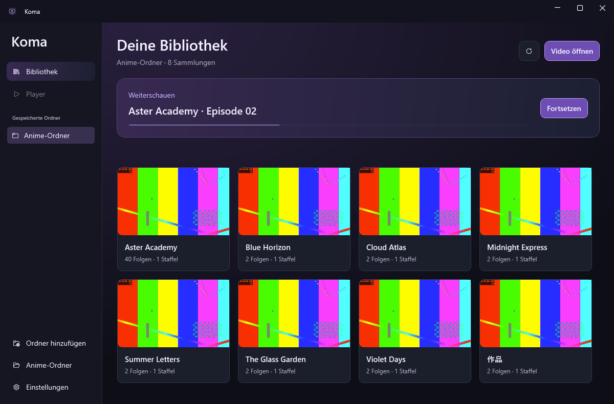

# Koma

[English](README.md) · [Deutsch](README.de.md) · [Français](README.fr.md)

Ein Anime-Player für Windows mit **Anime4K-Upscaling in Echtzeit**. Anime auf dem PC behalten, Folge öffnen und lossehen.

**[v0.2.2-beta.1 herunterladen](https://github.com/Xanive/Koma/releases/tag/v0.2.2-beta.1)** · Windows 11 x64 · Installer oder portable ZIP

## Loslegen

1. Installiere Koma oder entpacke die **gesamte** portable ZIP und öffne `Koma.exe`. Alles für die Wiedergabe ist dabei.
2. Lege Folgen unter **Videos → Anime** ab. Für eine Sammlung auf einem anderen Laufwerk wählst du **Ordner hinzufügen**.
3. Wähle eine Serie und starte die Wiedergabe. Du kannst auch ein Video oder einen Ordner in Koma ziehen.

Deine Dateien bleiben an ihrem Platz. Koma merkt sich deinen Fortschritt.

Koma aktualisieren

Schließe Koma und starte den neuen Installer. Einstellungen, Bibliothek, Verlauf und Download-Warteschlange bleiben erhalten.

Entpacke beim portablen Update in einen neuen Ordner und kopiere vor dem Start deinen bisherigen `data`-Ordner hinein. Geschützte Konto- und Download-Daten funktionieren nur mit demselben Windows-Konto.

Beta-Downloads sind nicht signiert. Windows kann deshalb eine Herausgeberwarnung anzeigen. Prüfsummen stehen auf der Release-Seite.

## Funktionen

- Ordnerbasierte Bibliothek mit Staffeln, Titelbildern und **Weiterschauen**.
- MKV und MP4, mehrere Audiospuren, Untertitel, Kapitel und Wiedergabetempo.
- Vollbildsteuerung, die beim Schauen ausgeblendet wird.
- Optionales MyAnimeList-Tracking und integrierte Downloads.
- Oberfläche auf Deutsch, Englisch und Französisch.

## Upscaling

Starte mit **Auto**. Der Modus passt die Qualität an, wenn deine Grafikkarte nicht nachkommt. Upscaling verändert das Bild bei der Wiedergabe; deine Videodatei bleibt unverändert.

| Modus | Ausgangspunkt |
| --- | --- |
| Auto | Empfehlung für den Alltag |
| A | Unscharfe Quellen, oft 1080p |
| B | Sanftere Bildaufbereitung, oft 720p |
| C | Entrauschen und Hochskalieren, oft 480p |
| Off | Originalwiedergabe |

Wähle, was für dich am besten aussieht. Unter **… → Mit Original vergleichen** kannst du genauer hinsehen. Bei Ruckeln schließe den Vergleich und probiere Auto oder Off.

## Steuerung

| Taste | Aktion |
| --- | --- |
| ← / → | Zurück- / vorspulen |
| ↑ / ↓ | Lautstärke |
| Leertaste | Wiedergabe / Pause |
| F oder F11 | Vollbild |
| Escape | Vollbild verlassen |
| M | Stummschalten |
| Strg+← / Strg+→ | Vorherige / nächste Folge |

Mit **Audio** und **CC** wechselst du die Spuren. In den **Einstellungen** änderst du Sprungweite, Lautstärkeschritte, Sprachen und die Ausblendzeit im Vollbild.

## Tracking und Downloads

**MyAnimeList:** Verbinde dein Konto mit einer eigenen registrierten Client-ID und aktiviere das automatische Tracking. Eindeutige Treffer erkennt Koma selbst; bei unklaren Serien wählst du einmal aus. Updates erfordern **80 % tatsächlich angesehene Wiedergabezeit**. Fortschrittsänderungen mit echten Konten müssen noch getestet werden. [Tracking einrichten](docs/Tracking.md) · [Den richtigen Anime wählen](docs/Recognition.md)

**Downloads:** Durchsuche Nyaa oder füge einen Magnet-Link oder Torrent hinzu. Fertige Folgen erscheinen in der Bibliothek. Unfertige Downloads bleiben nach dem Neustart pausiert. [Download-Anleitung](docs/Downloads.md)

## Hilfe und Danksagungen

Bibliothek leer? Prüfe deinen Ordner und wähle **Bibliothek aktualisieren**. Bei anderen Problemen [erstelle einen Fehlerbericht](https://github.com/Xanive/Koma/issues/new/choose) mit deiner Koma-Version und einer kurzen Beschreibung.

Koma wurde vollständig per **Vibe Coding mit Codex** entwickelt. Das Upscaling stammt von **[Anime4K von bloc97 und Mitwirkenden](https://github.com/bloc97/Anime4K)**. Die Wiedergabe nutzt [mpv](https://mpv.io/), die Oberfläche [WPF UI](https://github.com/lepoco/wpfui).

Komas Code steht unter [GPL-3.0-or-later](LICENSE). [Drittanbieter](THIRD-PARTY.md) · [Koma selbst bauen](docs/Engine-provenance.md) · [Release-Tests](docs/Release-testing.md)

Weitere Screenshots

Diese Screenshots zeigen Beta 5 mit Beispielsammlungen und erzeugten Testvideos.

