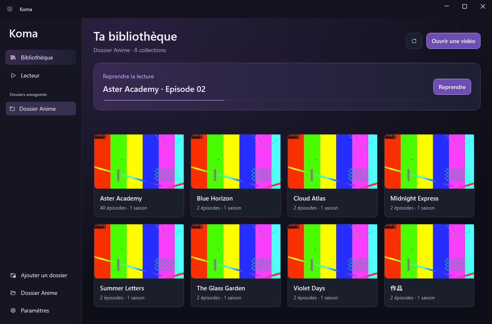
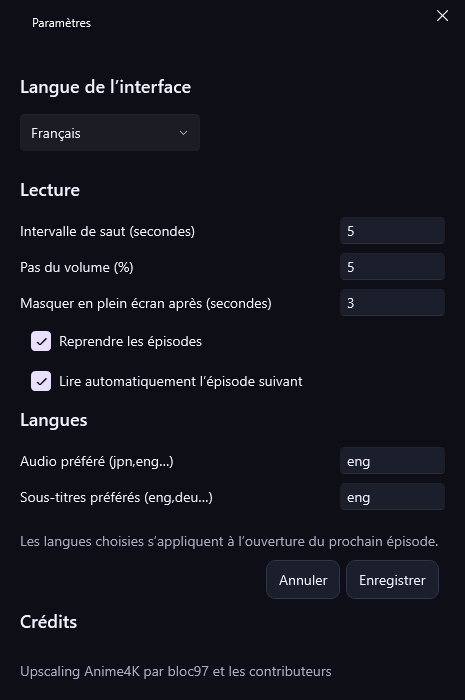
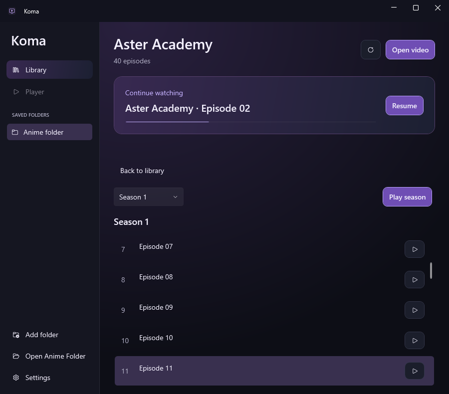
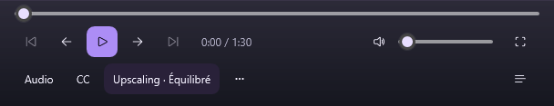

# Koma

[English](README.md) | [Deutsch](README.de.md) | [Français](README.fr.md)

Un lecteur d'anime hors ligne pour Windows avec mise à l'échelle Anime4K en temps réel. Parcourez **Videos → Anime**, ajoutez des dossiers provenant d'autres disques et reprenez vos épisodes avec une mise à l'échelle adaptative pendant la lecture.

Koma a été entièrement développé en « vibe coding » avec Codex. La mise à l'échelle utilise [Anime4K de bloc97 et des contributeurs](https://github.com/bloc97/Anime4K), la lecture utilise [mpv](https://mpv.io/) et l'interface utilise [WPF UI](https://github.com/lepoco/wpfui).



Les captures montrent la bêta 5 avec des clips de test synthétiques et des noms de collections fictifs.

## État de la bêta

[La bêta 5 est la version publique actuelle](https://github.com/Xanive/Koma/releases/tag/v0.1.0-beta.5). Elle comprend la nouvelle bibliothèque, les commandes de lecture révisées et une interface en anglais, allemand ou français.

La bêta 5 a réussi les vérifications automatisées de la bibliothèque, des paramètres, des vignettes et des traductions, ainsi que les vérifications de lecture et d'interface à partir du paquet distribué. Son programme d'installation a été compilé. L'installation avec ce programme de la bêta 5, un environnement Windows vierge, la mise à l'échelle réelle de l'affichage et les écrans avec des réglages DPI différents, ainsi que les performances sur GPU intégré restent à tester. Consultez le [guide de test des versions](docs/Release-testing.md).

Le code source comprend aussi un tableau de suivi MyAnimeList facultatif, la reconnaissance automatique des anime et la progression des épisodes. Les correspondances certaines peuvent être associées automatiquement ; les cas incertains proposent un choix avec affiche, titres, année et nombre d'épisodes. Cet aperçu de développement ne fait pas partie de la bêta 5. La connexion et le chargement de la liste ont fonctionné ; les mises à jour réelles de progression restent à valider. Consultez le [guide de reconnaissance](docs/Recognition.md) et le [guide du suivi](docs/Tracking.md). Le code source comprend aussi un [aperçu des téléchargements intégrés](docs/Downloads.md), avec recherche Nyaa et moteur MonoTorrent ; il ne fait pas partie de la bêta 5.

<details>
<summary>Autres captures d'écran</summary>

### Langue de l'interface et paramètres de lecture



### Saisons et épisodes



### Commandes de lecture compactes



Toutes les captures utilisent des clips de test synthétiques. Elles montrent l'interface et son agencement.

</details>

## Installer et ouvrir votre collection

1. Téléchargez le programme d'installation ou le ZIP portable pour Windows 11 x64 depuis [GitHub Releases](https://github.com/Xanive/Koma/releases). L'environnement d'exécution et le moteur de lecture sont inclus. Pour la version portable, extrayez tout le ZIP dans un dossier accessible en écriture et ouvrez `Koma.exe`.
2. Placez les fichiers vidéo ou les dossiers de saisons dans **Videos → Anime**. Le programme d'installation crée ce dossier. L'application portable le crée au premier lancement. Vous pouvez aussi le créer vous-même auparavant.
3. Ouvrez le lecteur et choisissez un épisode. Pour utiliser des fichiers ailleurs, sélectionnez **Ajouter un dossier**. Vous pouvez aussi glisser des fichiers ou un dossier dans l'application pour lancer la lecture.

Les paquets bêta ne sont pas signés. Windows peut afficher un avertissement concernant l'éditeur ou la réputation de l'application. Chaque version inclut `SHA256SUMS.txt` pour vérifier le téléchargement.

Le lecteur conserve les fichiers vidéo à leur emplacement d'origine. Les préférences et l'historique de lecture de l'application installée sont stockés sous `%LOCALAPPDATA%\Koma`. La version portable les stocke dans son propre dossier `data`.

Si vous utilisiez une bêta installée de Local Anime Player, Koma récupère ses dossiers enregistrés et son historique de lecture au premier lancement. Pour mettre à jour une bêta portable, copiez son dossier `data` dans le nouveau dossier Koma extrait avant de lancer l'application.

## Choisir la mise à l'échelle

Ouvrez **Upscaling** pendant la lecture. Commencez par **Auto**, puis essayez un mode manuel si vous souhaitez un rendu différent.

| Choix | Fonctionnement | Quand l'essayer |
| --- | --- | --- |
| Auto | Commence avec le mode A en qualité Balanced. Passe à Performance, puis à Off si des pertes d'images répétées indiquent que le GPU peine à suivre. | Pour la lecture quotidienne et sur un PC que vous ne connaissez pas. |
| A | Restaure les lignes floues, puis agrandit l'image. Utilise le préréglage fixe de shaders VL. | Pour la plupart des anime en 1080p et les sources présentant du flou. |
| B | Applique une restauration plus douce, puis agrandit l'image. Utilise le préréglage fixe de shaders VL. | Pour de nombreuses sources en 720p, surtout les vidéos réduites présentant des halos ou des effets d'escalier. |
| C | Réduit le bruit pendant l'agrandissement, sans passe de restauration séparée. Utilise le préréglage fixe de shaders VL. | Pour certaines vidéos réduites en 480p et les sources plus propres nécessitant moins de restauration. |
| Off | Désactive les shaders Anime4K et poursuit la lecture vidéo normale. | Pour examiner l'image source ou réduire la charge du GPU. |

A, B et C ciblent différents défauts d'image. Essayez-les sur la même scène et choisissez celui que vous préférez. Ces points de départ suivent le [guide Anime4K pour Windows](https://github.com/bloc97/Anime4K/blob/master/md/GLSL_Instructions_Windows_MPV.md) et le [guide avancé des modes](https://github.com/bloc97/Anime4K/blob/master/md/GLSL_Instructions_Advanced.md).

Auto utilise les shaders plus petits M et S pour Balanced et Performance. Il revient à Balanced à chaque épisode et lorsque vous sélectionnez de nouveau Auto. Les modes manuels conservent leur préréglage. La mise à l'échelle modifie l'image affichée pendant la lecture et laisse le fichier vidéo intact.

Pour examiner le résultat de plus près, choisissez **⋯ → Comparer à l’original**. **Détails** agrandit les deux vues. La comparaison utilise une seconde vue de lecture et augmente la charge.

## Lecture et bibliothèque

**Audio** et **CC** permettent de changer de piste. Dans une fenêtre étroite, **⋯** contient aussi les commandes de vitesse et de chapitres. **Paramètres** permet de modifier les pas de déplacement et de volume, les préférences audio et sous-titres, ainsi que le délai de masquage des commandes en plein écran. Vous pouvez aussi choisir English, Deutsch ou Français pour l'interface. Enregistrez le réglage pour l'appliquer et conserver votre choix au prochain lancement.

La bibliothèque présente votre collection sous forme de cartes. Ouvrez une série pour choisir sa saison et son épisode. Pour les illustrations, placez `cover.jpg`, `cover.png`, `folder.jpg` ou `folder.png` dans le dossier de la série ou de la saison. Sinon, Koma génère une vignette à partir d'un épisode local. Les vignettes sont mises en cache dans le dossier de données de l'application et générées lorsque la lecture est inactive ou en pause.

| Raccourci | Action |
| --- | --- |
| Gauche / Droite | Reculer / avancer |
| Haut / Bas | Augmenter / diminuer le volume |
| Ctrl+Gauche / Ctrl+Droite | Lire l'épisode précédent / suivant de la file |
| Espace | Lecture / pause |
| F ou F11 | Basculer le plein écran |
| Échap | Quitter le plein écran |
| C | Activer / fermer la comparaison |
| M | Activer / désactiver le son |
| Ctrl+O | Ouvrir des fichiers |

## Matériel et performances

Koma cible Windows 11 x64. Les paquets téléchargés incluent .NET et mpv, sans installation séparée d'un environnement d'exécution. Anime4K utilise le GPU. La charge dépend de la résolution source, de la fréquence d'images, de la taille de la fenêtre ou de l'écran et du préréglage choisi. Les modes manuels A, B et C utilisent des shaders plus exigeants qu'Auto.

Sur la RTX 3060 du PC de développement, une validation antérieure du moteur a lu 60 secondes de vidéo HEVC en 1080p à 24 images par seconde avec décodage matériel et aucune image perdue par le moteur de rendu ou le décodeur. Ce résultat précède la nouvelle interface de la bêta 5. La vérification du paquet de la bêta 5 confirme la lecture et le chargement des shaders sur ce PC. Les résultats sur d'autres matériels restent à vérifier.

En cas de saccades, commencez par Auto et fermez la comparaison. Essayez Off pour vérifier les performances sans Anime4K. Des fréquences d'images et des tailles de sortie plus élevées peuvent demander plus de temps de calcul au GPU. Gardez le pilote graphique à jour.

## Dépannage

| Problème | Solution à essayer |
| --- | --- |
| La bibliothèque est vide | Placez des médias sous **Videos → Anime** ou utilisez **Ajouter un dossier**, puis actualisez. Vérifiez qu'un disque amovible est connecté. |
| Les illustrations manquent | Ajoutez une image locale dans un format accepté ou mettez la lecture en pause et attendez la génération d'une vignette. Une illustration endommagée peut être remplacée par une vignette d'épisode. |
| Anime4K n'a pas pu démarrer | Extrayez de nouveau tout le ZIP portable et conservez ensemble les fichiers des shaders et du moteur. Koma lit la vidéo originale si le chargement des shaders échoue. |
| La lecture saccade | Choisissez Auto, fermez la comparaison et essayez Off. Consultez les remarques sur le matériel ci-dessus. |
| L'audio ou les sous-titres utilisent la mauvaise langue | Sélectionnez une piste sous **Audio** ou **CC**. Les langues audio et sous-titres préférées s'appliquent à l'ouverture du prochain épisode. **CC** permet aussi d'ouvrir un fichier de sous-titres externe. |
| Les préférences ou l'historique ne sont pas enregistrés | Vérifiez que le dossier de données de l'application installée ou le dossier portable `data` est accessible en écriture. Extrayez le ZIP portable dans un dossier où vous pouvez écrire. |
| Un clip ne s'ouvre pas | Essayez un autre fichier, puis signalez le conteneur, le codec et toute erreur visible pour le fichier concerné. |

[Signalez un problème de lecture, de bibliothèque ou d'affichage](https://github.com/Xanive/Koma/issues/new/choose). Indiquez la version de Koma, la version de Windows, le GPU, le mode de mise à l'échelle choisi et les étapes permettant de reproduire le problème.

## Compiler localement

Utilisez Windows 11 x64, le SDK .NET 10 sélectionné par `global.json`, Python 3.11 ou ultérieur, 7-Zip et NSIS 3.13. Exécutez ces commandes depuis la racine du dépôt dans PowerShell, avec ces outils disponibles.

```powershell
dotnet build Koma.slnx -c Release
dotnet run --project tests/Koma.Tests/Koma.Tests.csproj -c Release
./packaging/Build-Packages.ps1
```

La première compilation des paquets télécharge la version fixée du moteur MSYS2, son code source correspondant et les shaders. Elle place un programme d'installation, un ZIP portable, un ZIP des sources correspondantes et les sommes SHA-256 dans `dist/`. Prévoyez environ 1,8 Go de téléchargements. Utilisez `-EngineCacheDirectory` pour réutiliser les archives MSYS2 déjà téléchargées. Consultez la [provenance du moteur](docs/Engine-provenance.md) et les [composants tiers](THIRD-PARTY.md). L'option séparée `-LocalPreview` utilise le moteur de test d'origine pour les essais privés.

## Préparer une préversion GitHub

Lancez **Windows build and release draft** depuis **Actions**, définissez la version et choisissez **draft**. Le workflow vérifie les éléments verrouillés du moteur et prépare les deux téléchargements Windows avec les sources correspondantes pour validation. Suivez le [guide de test des versions](docs/Release-testing.md) avant de publier.

## Licence et crédits

Le code source de l'application est sous licence [GPL-3.0-or-later](LICENSE). Anime4K, mpv, WPF UI et les autres composants inclus conservent leurs propres licences. Consultez les [composants tiers et leurs mentions](THIRD-PARTY.md).
