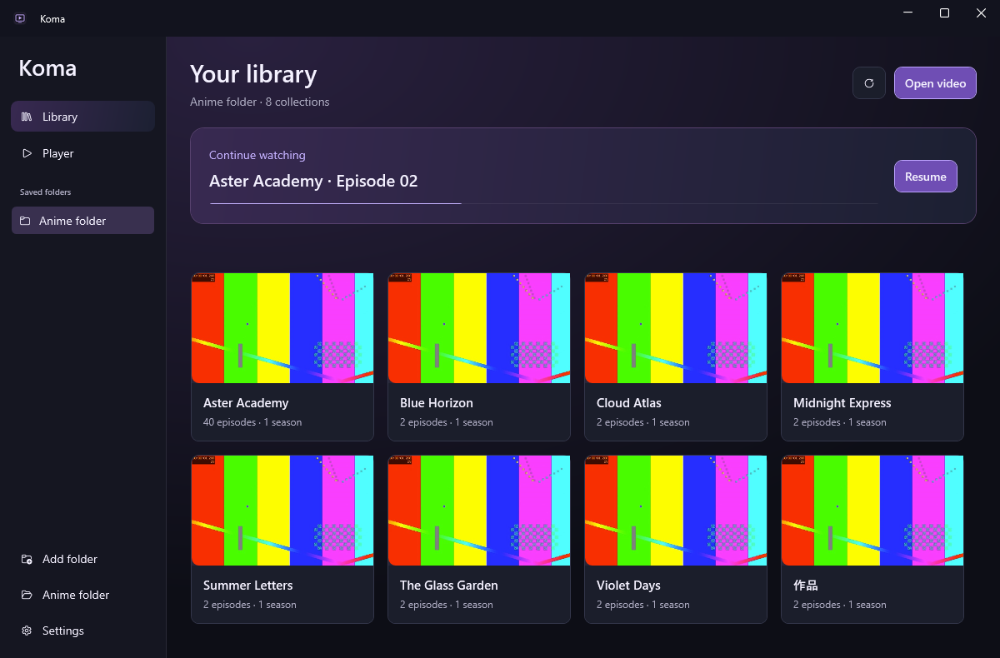
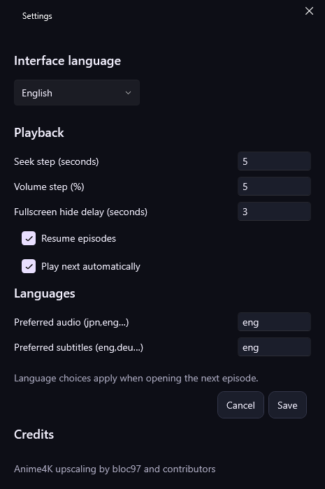

# Koma

[English](README.md) | [Deutsch](README.de.md) | [Français](README.fr.md)

An offline Windows anime player with real-time Anime4K upscaling. Browse **Videos → Anime**, save folders from other drives, and resume your episodes with adaptive upscaling during playback.

Koma itself was completely vibe coded with Codex. Upscaling uses [Anime4K by bloc97 and contributors](https://github.com/bloc97/Anime4K), playback uses [mpv](https://mpv.io/), and the interface uses [WPF UI](https://github.com/lepoco/wpfui).



Screenshots show beta 5 with synthetic test clips and sample collection names.

## Beta status

[v0.2.2-beta.1 is the current preview release](https://github.com/Xanive/Koma/releases/tag/v0.2.2-beta.1). It adds optional MyAnimeList tracking and a visual anime chooser, built-in downloads, and recovery for completed downloads missing from the library. Real-time Anime4K upscaling remains Koma’s main purpose.

The Windows build, 27 automated checks and 30 synthetic torrent scenarios passed, alongside packaged playback and interface checks. Live MyAnimeList progress updates, physical display scaling, integrated-GPU performance and broader long-transfer behavior still need validation. See the [release test guide](docs/Release-testing.md).

MyAnimeList requires a privately configured registered Client ID; no credentials are bundled. Automatic updates are optional and require 80% actual watched coverage. See the [matching guide](docs/Recognition.md), [tracking guide](docs/Tracking.md) and [download guide](docs/Downloads.md).

Close Koma before running the new installer; your saved folders, history, settings and download queue are preserved. For a portable update, extract the full ZIP into a new writable folder and copy your previous `data` folder before opening Koma. Protected account and download data remain tied to the same Windows account.


<details>
<summary>More screenshots</summary>

### Interface language and playback settings



### Seasons and episodes


### Compact playback controls


All captures use synthetic test clips. They demonstrate the interface and layout.

</details>

## Install and open your collection

1. Get the Windows 11 x64 installer or portable ZIP from [GitHub Releases](https://github.com/Xanive/Koma/releases). The runtime and playback engine are included. For the portable version, extract the whole ZIP into a writable folder and open `Koma.exe`.
2. Put video files or season folders in **Videos → Anime**. Setup creates this folder. In the portable app it appears on first launch, or you can make it yourself beforehand.
3. Open the player and choose an episode. To use files in another location, select **Add folder**. You can also drag files or a folder into the app to start playback.

Beta packages are unsigned and may show a Windows publisher or reputation warning. Each release includes `SHA256SUMS.txt` to verify the download.

The player leaves video files in their original location. Installed app preferences and watch history are stored under `%LOCALAPPDATA%\Koma`. The portable copy stores them in its own `data` folder.

If you used an installed Local Anime Player beta, Koma loads your saved folders and watch history from it on first launch. To upgrade a portable beta, copy its `data` folder into the newly extracted Koma folder before launching.

## Choose your upscaling

Open **Upscaling** during playback. Start with **Auto**, then try a manual mode if you want a different look.

| Choice | What it does | When to try it |
| --- | --- | --- |
| Auto | Starts with Mode A at Balanced quality. Drops to Performance, then Off if repeated frame drops indicate the GPU is falling behind. | Everyday playback and an unfamiliar PC. |
| A | Restores blurred lines, then upscales. Uses the fixed VL shader preset. | Most 1080p anime and sources with visible blur. |
| B | Applies softer restoration, then upscales. Uses the fixed VL shader preset. | Many 720p sources, especially downscaled material with ringing or aliasing. |
| C | Denoises while upscaling, with no separate restoration pass. Uses the fixed VL shader preset. | Some 480p downscales and cleaner sources that need less restoration. |
| Off | Clears Anime4K shaders and keeps normal video playback. | Checking the source image or reducing GPU work. |

A, B, and C target different image defects. Try them on the same scene and choose the one you prefer. These starting points follow the [Anime4K Windows guide](https://github.com/bloc97/Anime4K/blob/master/md/GLSL_Instructions_Windows_MPV.md) and [advanced mode guide](https://github.com/bloc97/Anime4K/blob/master/md/GLSL_Instructions_Advanced.md).

Auto uses smaller M and S shaders for Balanced and Performance. It starts at Balanced for each episode and when you select Auto again. Manual modes keep their selected preset. Upscaling changes the displayed image during playback and leaves the video file untouched.

For an optional closer look, choose **More → Compare with original**. **Detail** zooms the two views. Comparison runs a second playback view and increases the workload.

## Playback and library

**Audio** and **CC** switch tracks. **More** also contains speed and chapter controls in a narrow window. **Settings** lets you change seek and volume steps, audio and subtitle preferences, and the fullscreen control delay. You can also choose English, Deutsch, or Français for the interface. Save the setting to apply it and keep your choice for the next launch.

The library shows your collection as cards. Open a show to choose its season and episode. For artwork, put `cover.jpg`, `cover.png`, `folder.jpg`, or `folder.png` in the show or season folder. Koma otherwise generates a thumbnail from a local episode. Thumbnails are cached in the app's data directory and generated while playback is idle or paused.

| Shortcut | Action |
| --- | --- |
| Left / Right | Seek backward / forward |
| Up / Down | Raise / lower volume |
| Ctrl+Left / Ctrl+Right | Play the previous / next episode in the queue |
| Space | Play / pause |
| F or F11 | Toggle fullscreen |
| Escape | Exit fullscreen |
| C | Toggle Compare |
| M | Toggle mute |
| Ctrl+O | Open files |

## Hardware and performance

Koma targets Windows 11 x64. Packaged downloads include .NET and mpv, so no separate runtime installation is needed. Anime4K uses the GPU. The work depends on source resolution, frame rate, window or display size, and the selected preset. Manual A, B, and C use heavier shaders than Auto.

On the development RTX 3060, an earlier engine validation played 60 seconds of 1080p HEVC at 24 fps with hardware decoding and zero renderer or decoder drops. That result predates the beta 5 redesign. The beta 5 packaged playback check confirms playback and shader loading on this PC. Results on other hardware remain unverified.

For stuttering, start with Auto and close Compare. Try Off to check performance without Anime4K. Higher frame rates and larger output sizes can need more GPU time. Keep the graphics driver current.

## Troubleshooting

| Problem | Try this |
| --- | --- |
| The library is empty | Put media under **Videos → Anime**, or use **Add folder**, then refresh. Check that a removable drive is connected. |
| Artwork is missing | Add a supported local cover file, or pause playback and allow time for a generated thumbnail. A damaged cover can fall back to an episode thumbnail. |
| Anime4K could not start | Extract the whole portable ZIP again and keep its shader and engine files together. Koma falls back to the original video if shader loading fails. |
| Playback stutters | Choose Auto, close Compare, and try Off. See the hardware notes above. |
| Audio or subtitles use the wrong language | Select a track under **Audio** or **CC**. Preferred audio and subtitle languages apply when opening the next episode. **CC** can also open an external subtitle file. |
| Preferences or history do not save | Check that the installed app's data folder or portable `data` folder is writable. Extract the portable ZIP to a folder you can write to. |
| A clip fails to open | Try another file, then report the failing file's container, codec, and any visible error. |

[Report a playback, library, or visual issue](https://github.com/Xanive/Koma/issues/new/choose). Include the Koma version, Windows version, GPU, selected upscaling mode, and steps to reproduce it.

## Build locally

Use Windows 11 x64, the .NET 10 SDK selected by `global.json`, Python 3.11 or later, 7-Zip, and NSIS 3.13. Run these from the repository root in PowerShell with those tools available.

```powershell
dotnet build Koma.slnx -c Release
dotnet run --project tests/Koma.Tests/Koma.Tests.csproj -c Release
./packaging/Build-Packages.ps1
```

The first package build downloads the pinned MSYS2 engine, its corresponding source, and the shaders. It writes an installer, portable ZIP, corresponding-source ZIP, and SHA-256 checksums to `dist/`. Allow about 1.8 GB for downloads. Use `-EngineCacheDirectory` to reuse previously downloaded MSYS2 archives. See [engine provenance](docs/Engine-provenance.md) and [third-party components](THIRD-PARTY.md). The separate `-LocalPreview` option uses the original test engine for private testing.

## Draft a GitHub prerelease

Run **Windows build and release draft** from **Actions**, set the release version, and choose **draft**. The workflow verifies the locked engine inputs and prepares both Windows downloads together with the corresponding source for review. Follow the [release test guide](docs/Release-testing.md) before publishing.

## License and credits

The app's source is licensed under [GPL-3.0-or-later](LICENSE). Anime4K, mpv, WPF UI, and the other bundled components retain their own licenses. See [third-party components and notices](THIRD-PARTY.md).
