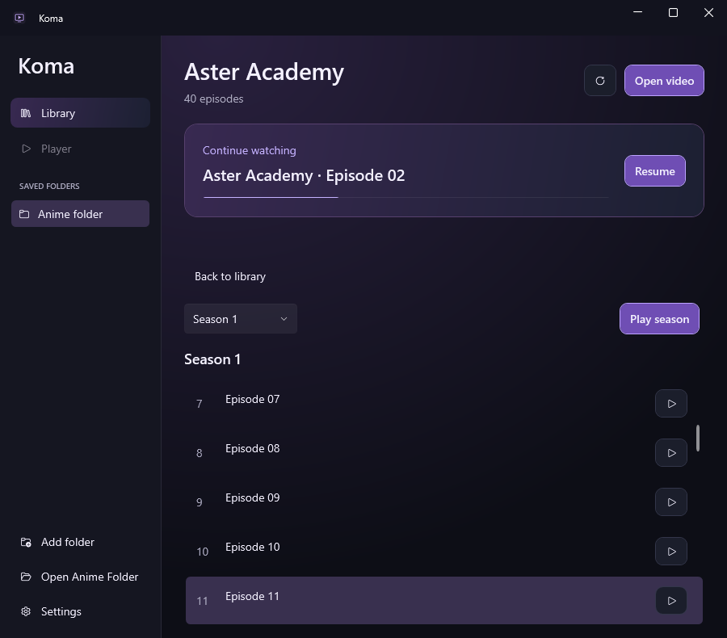
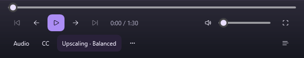

# Koma

[English](README.md) · [Deutsch](README.de.md) · [Français](README.fr.md)

A Windows anime player with **real-time Anime4K upscaling**. Keep your anime on your PC, open an episode, and watch.

**[Download v0.2.2-beta.2](https://github.com/Xanive/Koma/releases/tag/v0.2.2-beta.2)** · Windows 11 x64 · Installer or portable ZIP

## Start watching

1. Install Koma, or extract the **whole** portable ZIP and open `Koma.exe`. Everything needed for playback is included.
2. Put your episodes in **Videos → Anime**, or choose **Add folder** for a collection on another drive.
3. Pick a show and press Play. You can also drop a video or folder into Koma.

Your files stay where you keep them. Koma remembers your progress.

Updating Koma

Close Koma and run the new installer. Your settings, library, history and download queue are kept.

For a portable update, extract into a new folder, then copy your old `data` folder before launching. Protected account and download data only work with the same Windows account.

Beta downloads are unsigned, so Windows may show a publisher warning. Checksums are included on the release page.

## What's inside

- A folder-based library with seasons, artwork and Continue Watching.
- MKV and MP4 playback, multiple audio tracks, subtitles, chapters and speed controls.
- Fullscreen controls that fade away while you watch.
- Optional MyAnimeList tracking and built-in downloads.
- English, German and French interfaces.

## Upscaling

Start with **Auto**. It adjusts quality if your GPU struggles. Upscaling changes the picture while you watch; it doesn't rewrite your video.

| Mode | Starting point |
| --- | --- |
| Auto | Recommended for everyday watching |
| A | Blurred sources, often 1080p |
| B | Softer restoration, often 720p |
| C | Denoising and upscaling, often 480p |
| Off | Original playback |

These are starting points—choose what looks best to you. **More → Compare with original** gives you a closer look. If playback stutters, close Compare and try Auto or Off.

## Controls

| Key | Action |
| --- | --- |
| ← / → | Seek |
| ↑ / ↓ | Volume |
| Space | Play / pause |
| F or F11 | Fullscreen |
| Escape | Leave fullscreen |
| M | Mute |
| Ctrl+← / Ctrl+→ | Previous / next episode |

Use **Audio** and **CC** to change tracks. **Settings** lets you adjust seek steps, volume steps, languages and the fullscreen control delay.

## Tracking and downloads

**MyAnimeList:** click **Connect MyAnimeList**, sign in, then enable automatic tracking. No Client ID setup is needed in official releases. Clear matches are detected automatically; uncertain shows ask you to choose once. Updates require **80% actually watched**. Real account progress updates still need beta validation. [Tracking setup](docs/Tracking.md) · [Choosing the right anime](docs/Recognition.md)

**Downloads:** browse Nyaa or add a magnet/torrent. Completed episodes appear in the library. Unfinished downloads reopen paused. [Download guide](docs/Downloads.md)

## Help and credits

Empty library? Check your folder and press **Refresh**. For another problem, [report an issue](https://github.com/Xanive/Koma/issues/new/choose) with your Koma version and what happened.

Koma was completely **vibe coded with Codex**. Upscaling comes from **[Anime4K by bloc97 and contributors](https://github.com/bloc97/Anime4K)**. Playback uses [mpv](https://mpv.io/), and the interface uses [WPF UI](https://github.com/lepoco/wpfui).

Koma's code is [GPL-3.0-or-later](LICENSE). [Third-party credits](THIRD-PARTY.md) · [Build Koma](docs/Engine-provenance.md) · [Release testing](docs/Release-testing.md)

More screenshots

These screenshots show beta 5 with sample collections and generated test videos.

