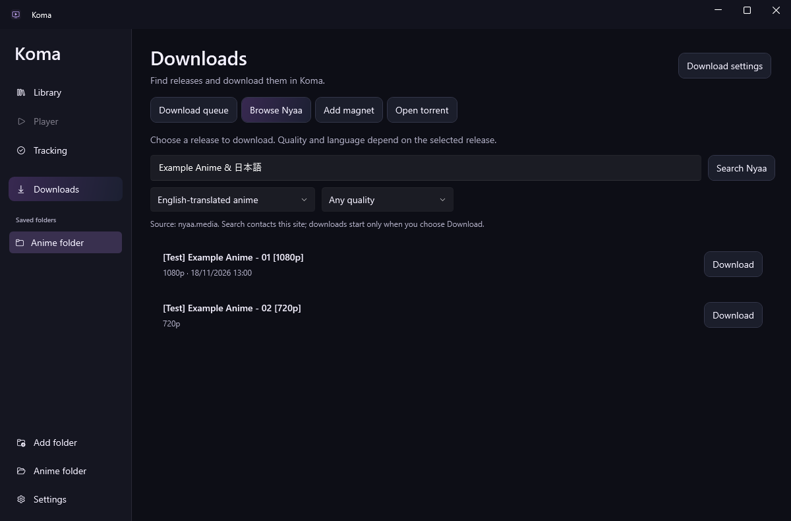

# Built-in downloads — development preview

Koma's current source includes a Downloads page powered by **MonoTorrent 3.0.2**. It uses an existing BitTorrent engine with Koma's interface and library integration. This development preview is not included in the public beta 5 downloads.

The screenshot uses synthetic release names and canned feed responses. It does not show a real download or account.

## Downloading

- **Browse Nyaa** searches the user-requested `https://nyaa.media/` source. Choose an anime category and optionally filter the loaded results by quality. Nothing contacts that site until Search is pressed. This identifies the configured website; it does not claim that the domain is an official or verified mirror of another service.
- Press **Download** beside a release to start it inside Koma. This site's RSS currently supplies detail-page links rather than direct torrent links, so Koma resolves only the selected page to a validated magnet. It does not render or run the page's HTML or scripts. [The site's RSS/search help](https://nyaa.media/help) describes its `page=rss`, `q`, `c` and `f` parameters.
- **Add magnet** accepts a BitTorrent magnet link. **Open torrent** imports a local `.torrent` file. Both use the same internal queue; a separate torrent client is not needed.
- **Download settings** chooses the destination for new jobs and bandwidth limits. Existing jobs retain their original destinations. Download speed defaults to unlimited; upload defaults to 1024 KiB/s. The upload limit must be at least 1 KiB/s.

The queue shows progress, state, downloaded size, download speed and upload speed. Pause and Resume control a job. Remove stops and removes the job from the queue while retaining its files. Removing a partial job does not promise automatic rediscovery of its staging data if it is added again later.

Torrents exchange pieces with peers while downloading. Koma stops sharing after completion and stops transfers when the app closes. Saved unfinished jobs reopen paused; Resume is an explicit action. The engine does not open peer listeners, contact trackers or start DHT merely because Koma or its Downloads page was opened. It does not automatically configure router port forwarding. Automatic subscriptions and download rules are not implemented in this preview.

## Completed episodes and playback

The default destination is the saved Anime folder. A separately chosen download folder is added to the local library if it is not already covered by a saved root. Each job uses a unique destination, retaining the torrent's internal file layout.

Unverified content stays under `.koma-incomplete/<job-id>` on the destination volume. Both library discovery and direct-file/folder opening exclude that staging path. After all pieces verify, Koma stops the job and publishes its directory with a same-volume move that refuses to overwrite an existing destination. Publication errors preserve the completed staging data for review.

Koma keeps normal filenames inside that excluded staging directory. This avoids a MonoTorrent 3.0.2 completion race where the transfer could report completion before its background `.!mt` filename changes finished, leaving completed videos invisible to the library. Publication now checks the exact expected filenames and sizes before moving the directory.

For older completed jobs still in the saved queue, startup detects temporary filenames and performs a full offline torrent hash check before restoring normal names and refreshing the library. This verifier has no listeners, trackers, DHT or peers. Invalid files, conflicting filenames and unavailable v2 hash layers preserve the originals and report an error; **Resume** retries verification. Removing a job removes its torrent metadata, so a removed job cannot use this automatic hash recovery.

Completion schedules a library refresh, including a follow-up when a scan is already active. It preserves the current video, pause state and playback queue. Downloads never automatically mark an episode watched or change MyAnimeList progress. [Account tracking](Tracking.md) still requires actual watched coverage and its separate permissions.

Koma remembers its published directories by saved-folder identity and relative path. Its generated outer download directory is excluded from recognition hints, while original internal show/season folders and filenames remain useful. These records survive queue removal and saved-folder relocation.

## Local data and dependencies

The job registry, magnet/tracker addresses and torrent metadata use Windows current-user protection in `downloads/private/download-queue.bin` under the app data directory. They are separate from MyAnimeList tokens and ordinary preferences. Unreadable protected queues are preserved as damaged files before replacement. A portable queue remains tied to the Windows account that protected it.

Nyaa queries and loaded feed results are not persisted. Feed requests do not include account credentials or cookies. Responses have byte, time and parsing limits; arbitrary operating-system URI handlers, webseeds and external metadata-source parameters are not launched. Peer transfer data is governed by the torrent protocol rather than these HTTP feed limits.

The package lock pins direct and transitive dependencies. Packaging verifies and ships MonoTorrent, Mono.Nat and ReusableTasks notices, and rejects a supplied publish directory containing profiles or test harnesses. See [third-party components](../THIRD-PARTY.md).

## Verification

- Release build and all **27 console checks** pass, including bounded feeds, source validation, incomplete-file isolation, recognition and preference persistence.
- A localhost-only pair of engines transferred a synthetic 23 MB HEVC fixture. Tests verified pause, shutdown/restart, resume and hash checking, exact SHA-256 content, one completed publication, zero upload after completion, collision protection and file retention. A separate magnet test verified actual local metadata exchange and a complete transfer. No internet peers or real anime content were used.
- The actual WPF interface passed offline startup, canned Nyaa search and selected-page resolution, metadata pause, queue actions, speed-limit validation, keyboard isolation and English/German/French layouts down to 680 × 480. A simulated publication during an existing scan was discovered by the follow-up without changing real paused mpv playback or its queue. Normal async shutdown passed as well.
- Read-only live requests verified the configured site's RSS format and resolution of a selected detail page to a magnet. No public torrent or media download was started.
- A clean self-contained publish passed dependency-notice checks; packaging rejected a test private-data directory. Local update installers have been built; these features have not been published in a GitHub release.
- The standalone `tests/Koma.Torrent.Tests` suite adds 30 synthetic scenarios: actual localhost transfers in four torrent formats, deterministic leftover temporary filenames, verified legacy recovery, corruption and collision preservation, cancellation/shutdown retries, and missing-v2-hash rejection. It is included in the solution and Windows workflow. After building, run `dotnet tests/Koma.Torrent.Tests/bin/Release/net10.0-windows/Koma.Torrent.Tests.dll` on Windows. Tests generate their own small temporary payloads and never use the real Koma profile.
- An offscreen WPF startup test loaded a synthetic legacy encrypted queue, verified and restored its completed temporary file, and confirmed its collection appeared on Home without a manual refresh or a normal peer engine. The existing Downloads interface and paused-playback refresh checks also passed.

The owner confirmed actual torrent downloading works. Broader public-peer behavior, long transfers, interrupted power/network recovery, physical DPI and another PC remain release checks. Live MyAnimeList connection and list loading worked; actual progress updates remain unverified separately from downloads.
