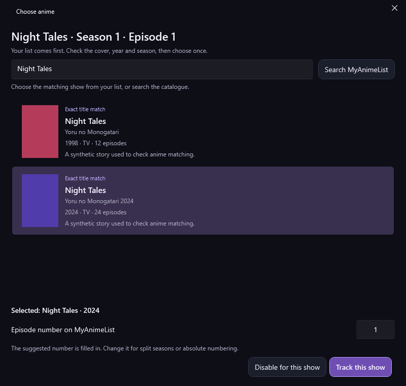

# Automatic anime matching — beta preview

Koma identifies the anime being watched and connects it to MyAnimeList. This feature is included experimentally in v0.2.2-beta.1. Account connection and list loading have been verified; live watch-count updates remain unverified. No identifier or token is included in source or packages.

## The normal flow

Connect MyAnimeList once, then enable **Automatically identify anime and update MyAnimeList** on Tracking. Koma first compares the episode's filename and folder hints against titles and aliases on the account's loaded list. It loads list pages automatically, with a bounded refresh; a partial list is not treated as proof of uniqueness. When necessary, it searches the catalogue for the selected or playing title. There is no separate catalogue toggle to discover before account tracking can work.

A unique exact title or alias with compatible media type, season and known episode bounds can link automatically and use normal zero-offset numbering. A numbered TV episode is distinguishable from a movie with the same title. Two remakes with the same alias remain a choice, even if their episode counts differ. Fuzzy suggestions, incomplete results, specials, ranges and unknown numbering do not silently become progress updates.

The player displays the matched show, episode and actual watched percentage, or the reason tracking needs attention. **Change anime match** opens the chooser directly from playback. The banner is hidden in fullscreen to keep the video focused. Progress still requires 80% actual watched coverage; seeking to the ending does not count.

## Choosing once

**Review match**, **Review tracking** and **Change anime match** use one chooser. It shows cover art when available, English and original titles, year, media type, episode count, a short summary, and badges for recommendations and entries already on the user's list. A recommendation alone does not authorize an update.

Select the right card and press **Track this show**. The episode number is already filled in; change it for absolute numbering or a split season. This one action remembers the show and number offset. A manually reviewed numeric episode can resolve conflicting title/folder hints, while ranges or missing episode numbers still require a clearer source. Disabled shows stay disabled across subsequent detection. Changing a remembered title invalidates the previous numbering permission.

Search works as an explicit action even when automatic tracking is off. Catalogue search sends the anime title, never video data, filenames, full paths or detailed watch intervals. Connection controls are kept out of the normal connected matching flow. The registered Client ID remains protected for the current Windows user; it is never bundled or requested in chat.

## Data and verification

Saved mappings and numbering permissions use saved-folder identity and relative directory information, preserving compatible choices after relocation. User selections beat late background responses. Account data, candidates and covers are transient; covers use a bounded 64-entry memory cache, two concurrent requests, short deadlines and validated HTTPS anime-image hosts. No account credentials accompany cover requests, and no image cache is written to disk.

The Release build and all 27 console checks pass. Actual WPF tests with a synthetic account verified full-list paging, English aliases, automatic TV/movie distinction, catalogue fallback, zero-offset numbering, one canned progress update after qualifying coverage, duplicate prevention, per-show disable, ambiguous remakes, cover/year choices, one-action show/number confirmation, and compact English/German/French layouts. No real account was updated in these tests.

Earlier live catalogue checks verified automatic and manual recognition for Frieren. The installed account connection/list read also worked. Live progress writing, physical DPI and broader real naming examples remain release checks. See [tracking](Tracking.md) for progress rules and account handling.
