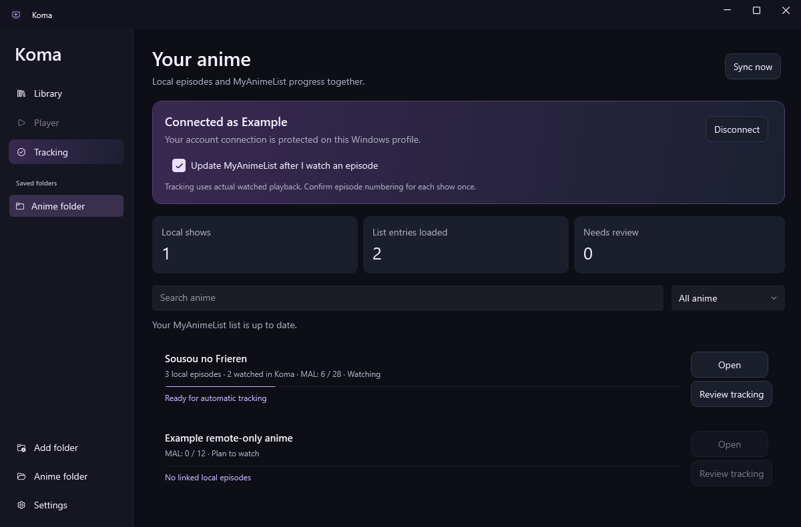

# MyAnimeList tracking

Connect MyAnimeList to see your list in Koma and update episode progress while you watch. Tracking is optional; local playback works without it.

## Set it up

1. Open **Tracking → Connect MyAnimeList**.
2. Sign in and approve Koma in your browser. Official releases use Koma's app registration, so you don't need to create a Client ID.
3. Turn on **Automatically identify anime and update MyAnimeList**.

Existing account connections keep working after an update. **Advanced connection** still lets you use your own registration if you prefer; it's optional.

Koma tries to identify the show automatically. If it needs help, use **Change anime match**. [Choosing the right anime](Recognition.md)

## When progress updates

An episode needs **80% actual watched coverage**. Skipping to the ending doesn't count.

Episodes update in order. If MyAnimeList says episode 4 and you watch episode 6, Koma waits for episode 5 before advancing. Rewatches, conflicting progress and shows marked on hold, dropped or completed need review.

The dashboard shows the current status. Use **Sync now** to refresh or retry. Koma updates episode progress and, when needed, Watching/Completed status; it leaves scores, notes and tags alone.

## Privacy and disconnecting

Koma sends anime titles for matching and show IDs/progress for tracking. Your videos, file paths and detailed viewing history stay on your PC.

Sign-in details are protected for your Windows account. **Disconnect** removes the saved account connection and turns automatic updates off. Your local library and progress remain.

**Beta note:** account connection and list loading have been tested. Real progress updates still need live validation. Airing schedules and release reminders aren't available yet.

